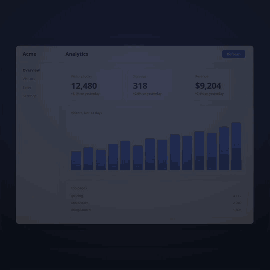

# livereel

[](https://github.com/vrppaul/livereel/actions/workflows/ci.yml)
[](https://www.npmjs.com/package/livereel)
[](https://nodejs.org)
[](LICENSE)



Film your live web app as a directed short: a camera that leans and
travels, a light on the block that matters, a cursor that moves like a
hand, captions that come up word by word. The app is real — clicks, typing
and its server's answers happen in it — and every frame is shot on a clock
of the film's own, so a slow server costs the film nothing.

A film is a TypeScript file of steps. An agent writes it for you: livereel
comes with a skill that teaches Claude Code to direct one.

## Why not a screen recording

- **The film keeps its own time.** A frame is a moment of the film, however
  long the browser took to draw it: waits, slow answers and loading vanish,
  and the camera moves as smoothly at 30 frames a second as it was written.
- **The page is live.** livereel films the app itself, in Chromium, not a
  copy of it: a click is a real click and a reply is the server's.
- **It is directed, not cut.** The camera frames a block by its selector,
  the light follows what the caption talks about, and the film is written
  in a director's words: `camera.onto`, `light.to`, `caption.show`.

## Quick start

It needs Node 22.20 or later and ffmpeg on the path. A film is an ES module:
the project's `package.json` says `"type": "module"`.

```bash
npm i -D livereel
npx livereel setup                            # the browser a film is shot in; checks ffmpeg
npx livereel shoot film.ts --out out --sheet  # out/film-square.mp4, and a frame a second in out/film-square-sheet.png
```

`film.ts`, a whole film of a page on the web:

```ts
import { atAddress, camera, caption, defineFilm, hold, light, play } from 'livereel';

// The line that says what the page is for
const LINE = 'p[lang=en]';

export default defineFilm({
	formats: { square: { frame: { width: 1080, height: 1080 }, screen: { width: 1440, height: 1080 } } },
	serve: () => atAddress('https://example.com/'),
	ready: (context) => context.page.locator(LINE).waitFor(),
	steps: () => [
		play({ seconds: 1.2, moves: [camera.onto(LINE, { air: 120 }), light.on(LINE), caption.show('A page, filmed')] }),
		hold({ seconds: 1.5 })
	]
});
```

`npx livereel still film.ts --out out --at 1.0` shoots the one frame at a
moment, without the video; `--draft` shoots at the frame's own size, quicker
and softer.

A film may name several formats, `{ square: …, wide: … }`, each a frame and
the screen its page is laid out on; `--format wide` picks the one to shoot,
and every file is named after it. A framing by selector fits any frame; a
pose given in numbers is the film's to give per format, and `steps` is
handed the format's name after the whole screen's pose. `--as webm` and
`--as gif` make the video as WebM or GIF, each at the film's own frame and
rate; `--as mp4 --as gif` gives both from one take.

A film is heard too: a click as the cursor presses, a key for every stroke
typed, a chime as the ending comes up, each on its own frame. These are
livereel's own, quiet and CC0 ([`sounds/`](sounds/LICENSE.md));
`defineFilm` takes `sounds: { click, key, ending }`, files of the film's own
in their place, or `sounds: null` for none, and `music: { file, volume }`,
a track under the whole film, cut to its length and faded out at its end.
`sound.play(file)` plays a file of the film's at a moment of a step. A GIF
holds no sound.

`examples/example-com.ts` is a longer film, in acts, square or wide;
`examples/livereel-promo.ts`, the film at the top of this page, serves an
app of its own and clicks it for real.

## What a film is written with

A film is a list of steps:

| Step | |
|---|---|
| `play({ seconds, moves, ease })` | so many seconds of frames; each move runs over its share of the step |
| `hold({ seconds })` | so many seconds with nothing moving |
| `cut(...moves)` | moves made at once, between two frames |
| `act(action)` | the page acted on for real, with Playwright: a click, a reply waited for |

and the moves of each part of the scene:

| Part | Moves |
|---|---|
| `camera` | `to(pose)`, `onto(selector, { air, zoomAtMost, tilt, turn })` |
| `light` | `on(selector)`, `to(selector)`, `off()` |
| `cursor` | `to(selector)`, `click(action, { sound })`, `press({ sound })`, `release()`, `hide()` |
| `caption` | `show(text)`, `hide()` |
| `screen` | `rise()`, `lower()` |
| `terminal` | `open(title)`, `type(strokes)`, `submit()`, `works(lines, thinking)`, `leave()` |
| `ending` | `show({ name, line, command })` |
| `page` | `scrollBy(selector, { pixels })`, `scrollTo(selector, { top })`, `type(strokes)` |
| `sound` | `play(file)` |

Every move that runs over time takes a share of its step, `within: { start,
end }`, and a curve of its own, `ease`. `keystrokes(text, { seed, slipAt })`
types the way a person does: unevenly, with a slip now and then.

## For agents

The `reel` skill, [`skills/reel/SKILL.md`](skills/reel/SKILL.md), teaches an
agent to direct a film: the story first, then a storyboard, then the steps,
checked frame by frame on contact sheets and stills. Install it with
`npx skills add vrppaul/livereel`, or as a Claude Code plugin:

```
/plugin marketplace add vrppaul/livereel
/plugin install livereel@livereel-marketplace
```

## How it works

```
film.ts ──steps──▶ take ──scene, frame by frame──▶ stage page ──CDP screenshot──▶ ffmpeg ──▶ film-square.mp4 ──▶ .webm, .gif
                    │  │                              │                              ▲
                    │  └──sounds, each on its frame──────────────────────────────────┘
                    └──acts, scrolls, keys──▶ your app, live in the stage's frame
```

The stage is a page of livereel's own: your app sits in its frame, and the
camera, the light and the captions are drawn around and over it from the
scene of each frame. The stage decides nothing and keeps no time; the film's
clock is its frames.

## Limits

- What livereel films today: public pages, and apps served on your machine
  that need no sign-in. An app behind a sign-in is not filmed yet: in the
  stage's frame the page's own requests go without its cookies, so its data
  does not load. A page that redirects during a film keeps the address it
  asked for, so its relative addresses break. Both are planned
  ([`TODO.md`](TODO.md)).
- Chromium alone, headless.
- The page is asked for reduced motion and the light colour scheme. A page
  that animates anyway runs those animations on the wall clock, so two shots
  of it differ there.
- A page that refuses to be framed (`X-Frame-Options`, a CSP's
  `frame-ancestors`) is shown anyway: the filming browser takes the refusal
  off, and nothing else.

## Development

[`CONTRIBUTING.md`](CONTRIBUTING.md): the setup, the gates, how the source is
laid out, and how a release is made.

## License

MIT
